 

<h2 align="center">◈ PROFILE ◈</h2>

  
    
  

<h2 align="center">◈ ARSENAL ◈</h2>

  

<h2 align="center">◈ STATS ◈</h2>

 

<h2 align="center">◈ CONTACT ◈</h2>

  
  

  <code>Open to collaboration · mentoring · remote work</code>

